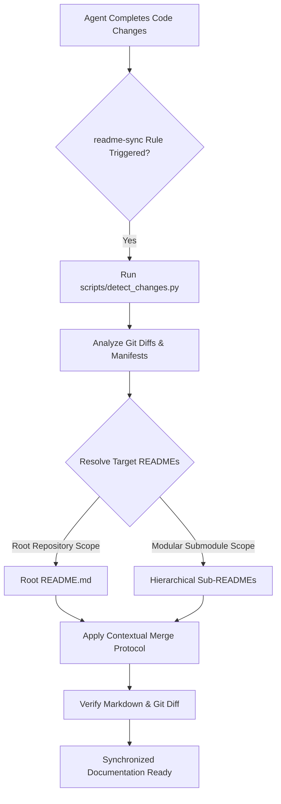

# readme-r

<p align="center">
  <strong>Autonomous README Synchronization & Maintenance Skill for Antigravity Agents</strong>
</p>

<p align="center">
  <a href="#-overview">Overview</a> •
  <a href="#-features">Features</a> •
  <a href="#-architecture">Architecture</a> •
  <a href="#-package-structure">Structure</a> •
  <a href="#-installation--setup">Installation</a> •
  <a href="#-usage--cli-reference">Usage</a> •
  <a href="#-companion-rule">Rule</a> •
  <a href="#-license">License</a>
</p>

<p align="center">
  
  
  
  
</p>

---

## 🌟 Overview

**`readme-r`** is a specialized Antigravity skill and companion rule that prevents documentation rot by automatically synchronizing, updating, and generating `README.md` files whenever code, dependencies, or project structures change.

Traditional documentation workflows often fall out of sync with code modifications. `readme-r` couples an automated change-detection script with an intelligent contextual merging engine. This ensures that new features, altered CLI arguments, updated environment variables, and new sub-modules are reliably documented without clobbering human-authored prose, brand voice, or custom layouts.

---

## ✨ Features

- **Autonomous Self-Execution**: Works seamlessly with [`rules/readme-sync.md`](./rules/readme-sync.md) so agents automatically evaluate and update README files after completing code changes or refactors.
- **Hierarchical Documentation**: Manages both root repository `README.md` files and nested submodule/package READMEs (e.g., monorepos, `packages/*`, `services/*`, `apps/*`, `skills/*`).
- **Contextual Merging Engine**: Surgically inserts and updates features, configuration tables, and command references while preserving existing human branding, tone, badges, and custom callouts.
- **Fast Change Detection Engine**: Includes a standalone Python utility ([`scripts/detect_changes.py`](./scripts/detect_changes.py)) that inspects git status, diffs, package manifests (`package.json`, `pyproject.toml`, `Cargo.toml`, `go.mod`), and environment files.
- **Modern GitHub Standards**: Ships with a comprehensive, professional template ([`resources/standard_template.md`](./resources/standard_template.md)) featuring shields, Mermaid diagrams, quick-start guides, and configuration tables.

---

## 🏗️ Architecture



---

## 📁 Package Structure

```text
readme-r/
├── SKILL.md                          # Main skill runbook and procedure instructions
├── scripts/
│   └── detect_changes.py             # Change detection & manifest inspection utility
├── resources/
│   └── standard_template.md          # Comprehensive GitHub README template blueprint
├── references/
│   └── doc_guidelines.md             # Contextual merge principles & style guidelines
├── rules/
│   └── readme-sync.md                # Companion rule to enforce automatic execution
├── .gitignore                        # Git exclusion rules
└── README.md                         # Project documentation and setup guide
```

---

## 🛠️ Installation & Setup

### 1. Global Installation (Machine-Local, All Projects)
To make `readme-r` available across all projects on your machine, install it into `~/.gemini/config/`:

```bash
# Create target skill and rules directories
mkdir -p ~/.gemini/config/skills/readme-r ~/.gemini/config/rules

# Clone or copy readme-r files
git clone https://github.com/kemaltombul/readme-r.git /tmp/readme-r
cp -r /tmp/readme-r/* ~/.gemini/config/skills/readme-r/
cp ~/.gemini/config/skills/readme-r/rules/readme-sync.md ~/.gemini/config/rules/readme-sync.md
```

### 2. Workspace Installation (Project-Specific)
To share `readme-r` with your team within a specific repository, place it inside `.agents/`:

```bash
# In your repository root:
mkdir -p .agents/skills/readme-r .agents/rules
cp -r /path/to/readme-r/* .agents/skills/readme-r/
cp .agents/skills/readme-r/rules/readme-sync.md .agents/rules/readme-sync.md
```

---

## 💡 Usage & CLI Reference

### Change Detection Helper

You can manually inspect what changes are detected in any working tree:

```bash
# Human-readable summary
python3 scripts/detect_changes.py

# Machine-readable JSON output
python3 scripts/detect_changes.py --json

# Target a specific repository path
python3 scripts/detect_changes.py --dir /path/to/repo --json
```

#### CLI Options

| Flag | Type | Description |
| :--- | :--- | :--- |
| `--dir <path>` | `string` | Target directory to inspect (defaults to current directory) |
| `--json` | `flag` | Output machine-readable JSON structure |
| `-h`, `--help` | `flag` | Display available help and arguments |

### JSON Output Schema

When invoked with `--json`, `detect_changes.py` outputs structured metadata:

```json
{
  "is_git_repository": true,
  "total_changed_files": 2,
  "changed_files": ["src/api.py", "package.json"],
  "git_status": {
    "modified": ["src/api.py", "package.json"],
    "added": [],
    "deleted": [],
    "untracked": []
  },
  "has_dependency_changes": true,
  "has_new_files_or_modules": false,
  "has_configuration_changes": false,
  "target_readmes": {
    "root_readme": {
      "path": "/workspace/README.md",
      "exists": true
    },
    "hierarchical_readmes": {}
  },
  "manifests": {
    "package.json": { ... }
  },
  "diff_snippet": "..."
}
```

---

## 📋 Companion Rule

The bundled [`rules/readme-sync.md`](./rules/readme-sync.md) rule activates whenever:
1. **New or Modified Functionality**: New features, updated API routes, CLI arguments, or changed component behaviors.
2. **Dependency & Environment Updates**: Added or removed packages in manifests (`package.json`, `pyproject.toml`, `Cargo.toml`, `go.mod`) or changed `.env` keys.
3. **Structural Changes**: New submodules, packages, or services created under `packages/`, `services/`, `apps/`, or `skills/`.
4. **Behavioral Refactors**: Architectural changes altering how developers run, test, build, or deploy.

---

## 📄 License

This project is licensed under the terms of the [MIT License](./README.md).
